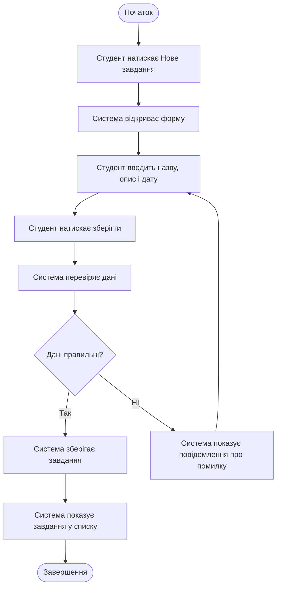

# Actvity-діаграма ключового процесу

## Загальна інформація

**Назва продукту:** Менеджер навчальних завдань.
**Осноний актор:** Студент.
**Процес:** створити навчальне завдання.
**Пов'язаний use case:** UC-01. Створити завдання.
**Пов'язаний user story:** US-01. Створити завдання.
**Пов'язана функціональна вимога:** FR-01.
**Мета процеса:** зберегти навчальне завдання та відобразити його у списку.

## Acitivty-діаграма

## Пояснення

Діаграма показує створення навчального завдання. Студент відкриває форму, вводить назву, опис і дату та натискає на збереження. Система перевіряє дані. Якщо вони правильні, завдання зберігається й відображається у списку. Якщо дані не правильн, система показує повідомлення про помилку, після чого студент повертається до введення даних.