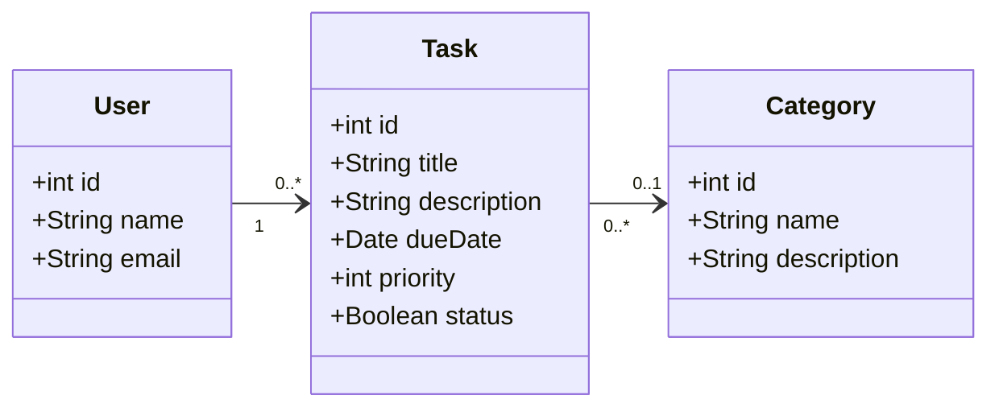

# Спрощена class-діаграма

## Загальна інформація

**Назва продукту:** TaskFlow Student

**Призначення діаграми:** показати основні стуності програмного продукту, їхні властивості та зв'язки.

**Межі моделі:** один поточний локальний профіль студента, його навчальні завдання та наперед визначений перелік категорій. Категорія завдання є необов'язковою.

## Основні класи

**User** - локальний профіль студента, якому належать завдання. Містить ідентифікатор, ім'я та електронну адресу.

**Task** - навчальне завдання. Містить ідентифікатор, назву, пріоритет, опис, дату виконання та статус.

**Category** - картегорія для групування завдань. Містить ідентифікатор, назву та опис.

## Class-діаграма

## Пояснення зв'язків

- Один користувач може мати від нуля до багатьох завдань.
- Кожне завдання належить рівно одному користувачу.
- Завданя може не мати категорії або належити одній категорії.
- Одна категорія може бути повєязана з будь-якою кількістю задвань.

## Відповідність попереднім матеріалам

Клас Task містить дані, потрібні для створення й редагування завдань відповідно до FR-01 та FR-03. Властивість status використуваується для зміни стану завдання відповідно до FR-05.

User представляє власника завдань у межах локального профілю. 

Category відповідає уточненій можливості необов'язково вибирати категорію під час створення та редагування завдання.