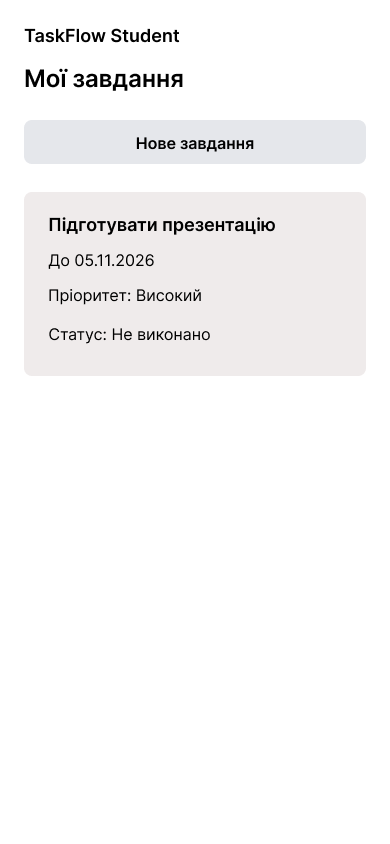
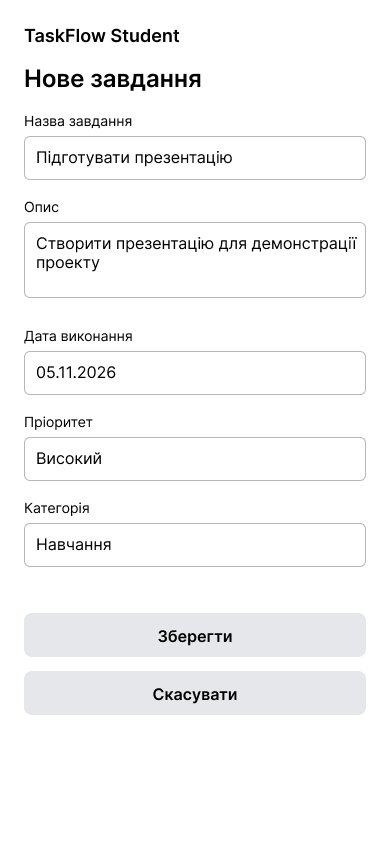
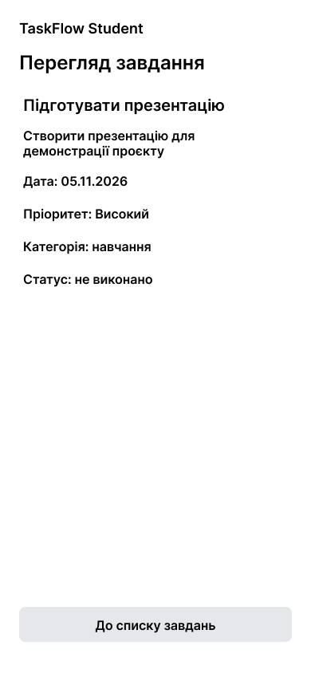
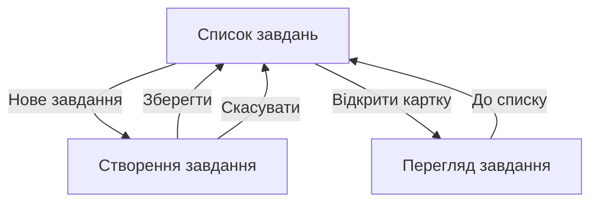

# Ескізи основних екранів

## Програмний продукт

TaskFlow Student.

## Основний сценарій

Студент переходить зі списку до створення завдання, переглядає заповнені дані та підтверджує дію. Після повернення до списку він може відкрити інформацію про завдання.

Сценарій пов’язаний зі створенням і переглядом завдань.

## Екран 1. Список завдань

Призначення: показати коротку інформацію про завдання та надати перехід до створення нового.

Основні елементи:
- назва продукту;
- заголовок «Мої завдання»;
- кнопка «Нове завдання»;
- картка з назвою, датою, пріоритетом і статусом.

Переходи:
- «Нове завдання» відкриває форму;
- картка відкриває перегляд завдання.

## Екран 2. Створення завдання

Призначення: показати поля введення даних нового завдання.

Основні елементи:
- назва;
- опис;
- дата виконання;
- пріоритет;
- необов’язкова категорія;
- кнопки «Зберегти» та «Скасувати».

Обидві кнопки повертають до списку. У готовому застосунку «Зберегти» підтверджує створення, а «Скасувати» завершує дію без збереження.

## Екран 3. Перегляд завдання

Призначення: показати повну інформацію про завдання.

Основні елементи:
- назва та опис;
- дата;
- пріоритет;
- категорія;
- статус;
- кнопка «До списку завдань».

## Схема переходів

## Figma

[Ескізи основних екранів](https://www.figma.com/design/MCeuqqepd01TZSuyjWXovL/TaskFlow-Student---Screens-and-Prototype?node-id=0-1&t=RpnAehcJL0ZfNOEN-1)