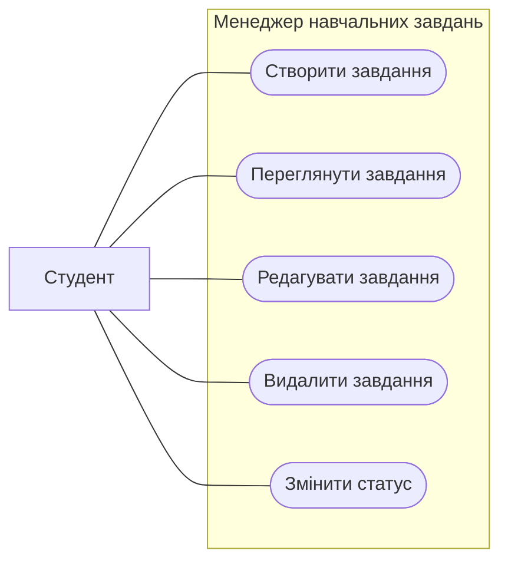

# Use-case модель програмного продукту

## Загальна інформація

**Назва продукту:** Менеджер навчальних завдань.
**Осноний актор:** Студент.
**Додаткові актори:** відсутні

## Опис акторів

**Студент** - основний актор. Створює, переглядає, редагує та видаляє навчальні завдання, а також змінює їх статус.

## Основні випадки використання

1. Створити завдання - US-01, FR-01.
2. Переглянути завдання  - US-025, FR-02.
3. Редагувати завдання  - US-03, FR-03.
4. Видалити завдання  - US-04, FR-04.
5. Змінити статус - US-05, FR-05.

## Use-case діаграма

## Основний сценарій

## UC-01. Створити завдання

**Мета:** додати нове завдання до списку.

**Основний актор:** студент.

**Передумова:** застосунок відкрито, студент перебуває на сторінці зі списком завдань

**Тригер:** студент натискає кнопку "Нове завдання"

**Основний сцераній:**

1. Система відкриває форму нового завдання
2. Студент вводить назву завдання
3. Студент додає опис завдання
4. Студент указує дату виконання
4. Студент натискає "Зберегети"
6. Система перевіряє введені дані
7. Система зберігає завдання і закриває форму
8. Система відображає нову завдання у списку

**Післяумова:** нове завдання збережено і відображається у списку
